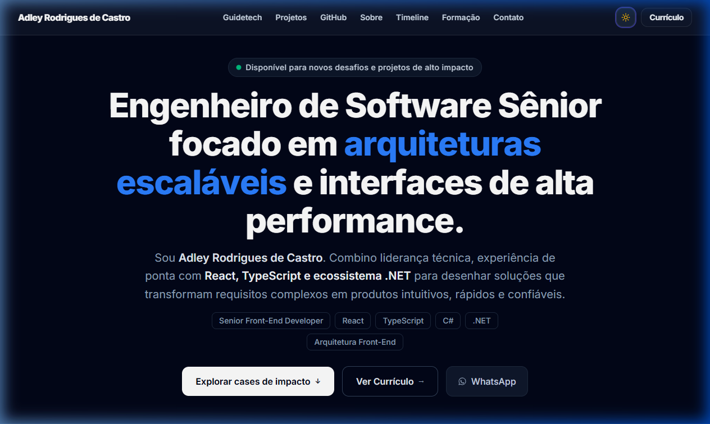
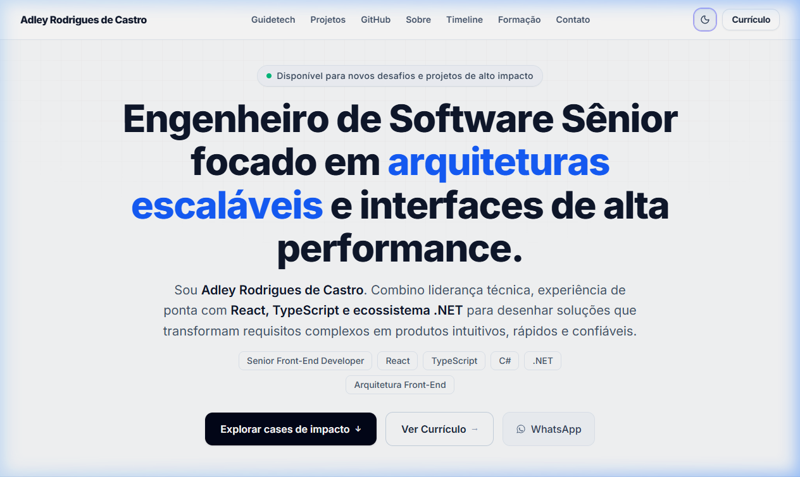
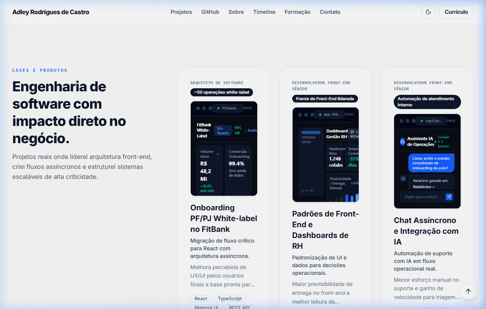

# ⚡ Adley Rodrigues • Senior Software Engineer Portfolio

<p align="center">
  <strong>Construindo arquiteturas escaláveis, ecossistema .NET, React, TypeScript e interfaces de alta performance.</strong>
</p>

<p align="center">
  <a href="https://portfolio-adley.vercel.app"></a>
  <a href="https://react.dev"></a>
  <a href="https://www.typescriptlang.org"></a>
  <a href="https://tailwindcss.com"></a>
  <a href="https://vite.dev"></a>
  <a href="https://www.framer.com/motion"></a>
  
</p>

---

## 🧭 Visão Geral

Este repositório contém o portfólio profissional de **Adley Rodrigues de Castro**, Engenheiro de Software Sênior e Líder Técnico com mais de 5 anos de experiência. Projetado sob os mais rigorosos padrões da engenharia moderna de front-end, o projeto combina estética minimalista de alta autoridade (inspirada no design system da Vercel, Linear e GitHub) com excelente performance de carregamento e governança de código.

---

## 📸 Showcase Visual

### Modo Escuro (Dark Mode — `bg-slate-950`)


### Modo Claro (Light Mode — `bg-slate-50`)


### Mockups de UI em Frames de Navegador (FitBank, Dashboards de RH & Chat IA)


---

## 🚀 Destaques de Engenharia & UX

- **Identidade Visual Monocromática:** Paleta de alto contraste (`slate-950` / `white`), com iluminação neutra em grid `#8080801a` e destaque exclusivo na cor azul elétrica para direcionar a hierarquia visual.
- **Animação BlurText Letra por Letra:** Componente customizado com Framer Motion (`blur(12px) -> blur(0px)`, `y: 12 -> 0`), segmentação tokenizada em palavras para blindagem contra quebras de linha em dispositivos móveis, e atributos de acessibilidade (`aria-label` e `aria-hidden`).
- **Simulação Fidedigna de Produtos (UI Mockups):** Substituição de vetores genéricos por esqueletos de UI de alta fidelidade estilizados com Tailwind CSS dentro de frames de navegador (onboarding bancário assíncrono, dashboard de gestão analítica e interface de chat com IA Claude).
- **Currículo Nativo & Otimização para Impressão:** Rota `/curriculo` com regras `@media print` dedicadas para geração de PDF em folha A4 com tipografia balanceada, quebras de página controladas e ocultação automática de elementos de navegação.
- **Arquitetura Zero-Junk & Code Splitting:** Eliminação de dependências legadas e pesadas (remoção de Material-UI e GSAP), unificando a stack em Tailwind CSS v4 e otimizando o bundle de produção via `manualChunks` no Rollup/Vite.
- **Lighthouse Triplo 100:** 100 em Acessibilidade (WCAG 2.1 AA), 100 em Melhores Práticas e 100 em SEO em todas as rotas principais.

---

## 🏗️ Arquitetura do Workspace

O projeto está organizado como um monorepo gerenciado por `pnpm workspaces`:

```text
portfolio-adley/
├── .github/
│   └── assets/                     # Screenshots de demonstração do README
├── meu-portfolio/                  # Aplicação Web SPA (Vite + React 19)
│   ├── public/
│   │   ├── og/
│   │   │   └── adley-portfolio.png # Cartão de compartilhamento Open Graph 1200x630
│   │   ├── favicon.svg
│   │   ├── robots.txt
│   │   └── sitemap.xml
│   ├── src/
│   │   ├── components/
│   │   │   ├── sections/           # HeroSection, ProjectsSection, AboutSection, etc.
│   │   │   ├── ui/                 # BlurText, ProjectMockupFrame, SpotlightCard, etc.
│   │   │   ├── SiteHeader.tsx      # Navegação principal e drawer mobile
│   │   │   └── SiteFooter.tsx      # Rodapé com canais de contato e links
│   │   ├── data/
│   │   │   └── siteContent.ts      # Dados estruturados de projetos, timeline e bio
│   │   ├── pages/
│   │   │   ├── HomePage.tsx        # Página inicial focada na carreira de engenharia
│   │   │   ├── CurriculoPage.tsx   # Currículo para leitura e impressão PDF
│   │   │   ├── ProjectsPage.tsx    # Listagem de cases de sucesso
│   │   │   └── ProjectCasePage.tsx # Estudo de caso aprofundado com MDX
│   │   ├── theme/                  # ThemeModeProvider (Dark/Light com localStorage)
│   │   ├── index.css               # Estilos base com Tailwind CSS v4
│   │   └── main.tsx
│   ├── package.json
│   ├── vite.config.ts              # Configuração com rollupOptions.manualChunks
│   └── vercel.json                 # Regras de SPA rewrites
├── package.json                    # Scripts raiz para o monorepo
├── pnpm-workspace.yaml
└── vercel.json                     # Configuração de build e rewrites para a Vercel
```

---

## 💻 Instalação e Execução Local

### Pré-requisitos
- **Node.js** >= 20.x
- **pnpm** >= 9.x (`corepack enable pnpm` ou `npm i -g pnpm`)

### 1. Clonar o repositório
```bash
git clone https://github.com/AdleyRodrigues/portfolio-adley.git
cd portfolio-adley
```

### 2. Instalar dependências
```bash
pnpm install
```

### 3. Iniciar o servidor de desenvolvimento
```bash
pnpm dev
```
O servidor estará disponível em `http://localhost:5173/` (ou na próxima porta livre).

### 4. Build de produção e preview
```bash
# Compilação TypeScript e empacotamento Vite
pnpm build

# Teste local do bundle final compilado
pnpm preview
```

---

## ⚡ Otimização de Performance no Build

A configuração do `vite.config.ts` divide o código em chunks isolados para maximizar o cacheamento no navegador do usuário:

| Chunk | Conteúdo | Tamanho Gzip |
|---|---|---|
| `react-vendor` | `react`, `react-dom`, `react-router-dom`, `react-helmet-async` | ~23 kB |
| `motion-vendor` | `framer-motion` | ~42 kB |
| `icons` | `lucide-react` | ~5 kB |
| `index` | Aplicação, componentes e páginas | ~90 kB |

---

## 🌐 Deploy na Vercel

O projeto está preparado para deploy contínuo na Vercel com suporte completo a roteamento SPA (Single Page Application):

1. **Root Directory:** `./` (ou `./meu-portfolio`)
2. **Build Command:** `pnpm --filter meu-portfolio build`
3. **Output Directory:** `meu-portfolio/dist` (ou `dist`)
4. **SPA Rewrites:** Definidos em `vercel.json` para redirecionar todas as rotas (`/curriculo`, `/projetos/:slug`) para `/index.html` sem erros 404 em recarregamento direto.

---

## 📬 Contato

- **LinkedIn:** [linkedin.com/in/adley-castro](https://www.linkedin.com/in/adley-castro/)
- **GitHub:** [github.com/AdleyRodrigues](https://github.com/AdleyRodrigues)
- **Email:** [adleyrc.job@gmail.com](mailto:adleyrc.job@gmail.com)
- **WhatsApp:** [+55 88 99244-5274](https://wa.me/5588992445274)

---

<p align="center">
  Desenvolvido por <strong>Adley Rodrigues de Castro</strong> • © 2026 Todos os direitos reservados.
</p>
